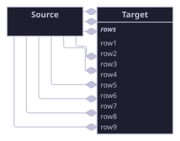
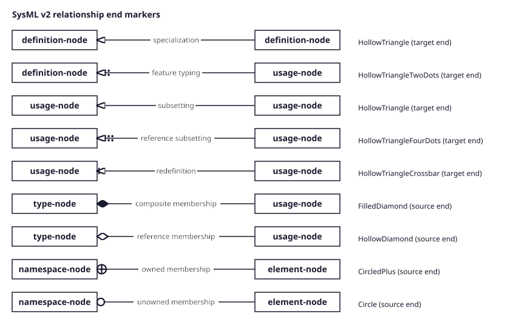
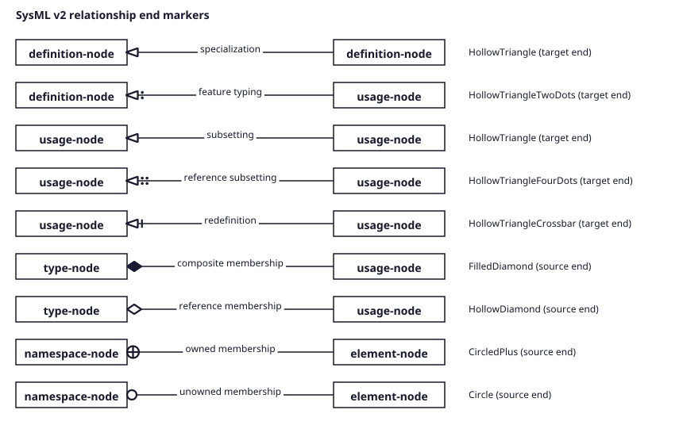
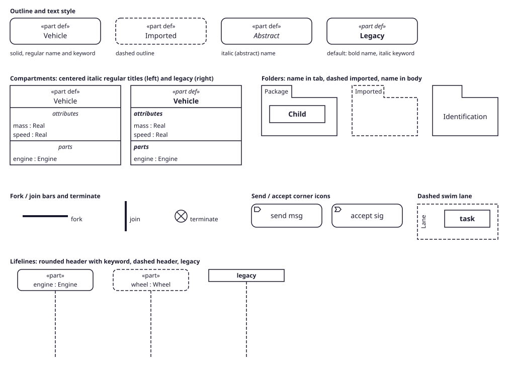
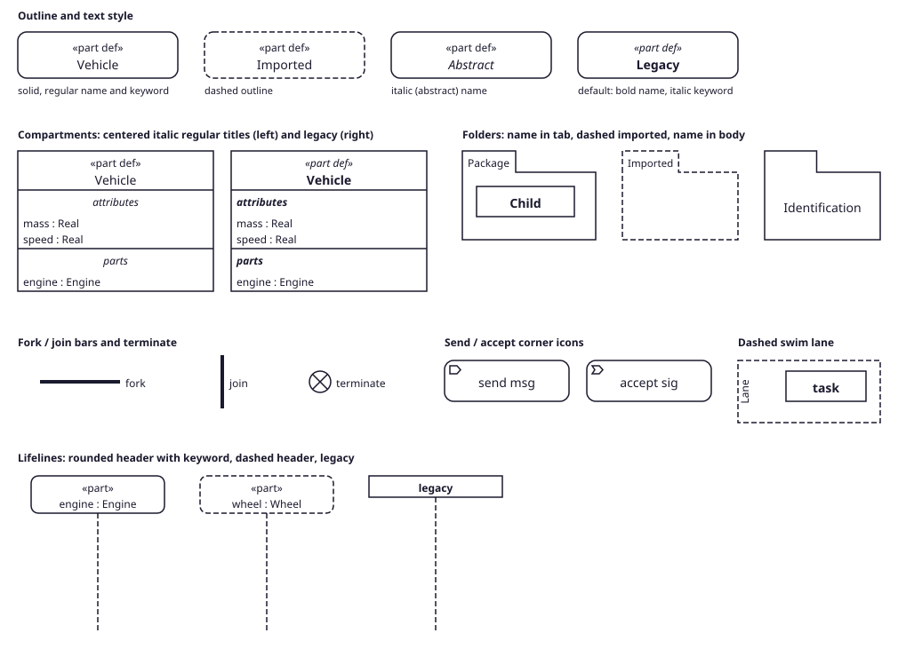
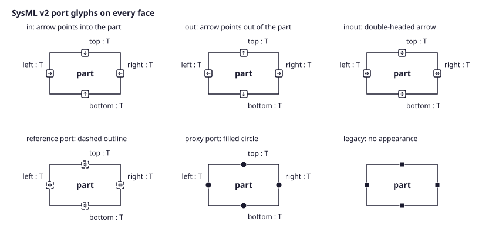
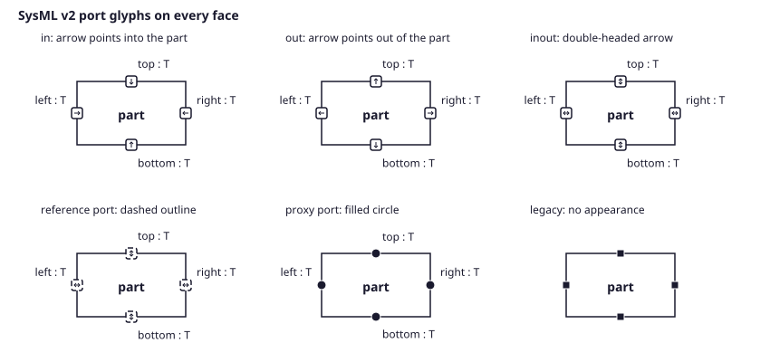

# Custom rendering

Every other group in this gallery shows what the layout engine itself produces: describe a graph, call
LayoutEngine.Layout, render the result. This group is the deliberate exception. Its diagrams are hand-built LayoutTrees
with boxes placed at explicit, hardcoded coordinates, rendered by calling ConnectorRouter and the renderers directly —
no layout algorithm is involved at all. This is a legitimate, fully public capability (every type used here is public),
so it earns its own honestly-labeled home rather than being mixed into a showcase of algorithm output. Expect rough
edges: nothing here benefited from any algorithm's spacing or routing intelligence, and a person taking this path on
their own diagrams should expect the same trade-off.

[Back to the gallery index](../README.md)

## Direct ConnectorRouter regression coverage

Regression coverage that requires an exact, hardcoded box arrangement no layout algorithm currently produces, kept as
permanent visual and numeric evidence that a specific connector-routing bug stays fixed regardless of which algorithm
(or future heuristic change) might eventually produce a similar arrangement.

Regression coverage for the OrthogonalEdgeRouter narrow-gap tangling fix: a small Source box placed explicitly beside a
taller, nine-row-compartment Target box with a narrow gap between them, joined by nine hand-routed connectors (bypassing
any layout algorithm, so this exact geometry stays covered regardless of which algorithm or future heuristic change
might produce it). Before the fix, each successive parallel connector's own soft-obstacle avoidance offset its candidate
lane a little further from the shared gap with no ceiling, eventually looping a route back behind the Source box it had
already left; the router now clamps soft-obstacle lane candidates to the box pair's own envelope and penalizes (without
blocking) any move that still leaves it. The router also now prices a connector transversally crossing another
already-routed connector's trunk (OrthogonalEdgeRouter's SoftObstacleCrossingCost), so a connector with a genuinely
bounded-cost non-crossing alternative takes it; this gap is saturated enough (nine connectors, one alternate lane) that
one connector's own approach stub still crosses two others' trunks here, because that connector is routed before the two
it later crosses and so cannot see them as obstacles yet — a known single-pass routing-order limitation, not a pricing
gap, left as documented residual behavior rather than force a much wider routing-order change for this one saturated
diagram.

## SysML-style notation primitives

Rendering primitives that carry no SysML knowledge but let a SysML view reproduce the standard graphical notation: the
relationship end markers (a hollow triangle trailed by two or four dots, a circled plus, diamonds, a circle, a
crossbar), dashed outlines, regular/italic/bold name and keyword styles, centered compartment titles, folders with the
name in the tab, thick fork/join bars, the terminate badge, send/accept corner icons, dashed swim lanes and rounded
lifelines. Each is an optional, backward-compatible property; the legacy appearance remains the default.

Every relationship end marker on a labeled two-box edge: specialization and subsetting (hollow triangle), feature typing
(triangle with two dots), reference subsetting (triangle with a 2x2 grid of dots), redefinition (triangle followed by a
bar behind its base), composite and reference membership (filled and hollow diamond), owned membership (circled plus)
and unowned membership (circle). Triangles are target ends and the membership glyphs source ends, proving both ends of a
line decorate identically.

The same sheet through the CanvasNet raster renderer, which draws every marker at the same size as the SVG renderer (the
notation size scaled by the theme stroke width).

Dashed and solid rounded boxes with regular, italic and legacy bold names; compartments with centered italic titles
beside the legacy left-aligned bold-italic ones; folders with the name in the tab (solid and dashed) and in the body;
thick fork/join bars; the terminate badge; send and accept corner icons; a dashed swim lane; and rounded lifelines with
a keyword line beside a legacy sharp one.

The same notation-primitives sheet through the CanvasNet raster renderer.

## SysML port glyph matrix

A hand-built sheet that puts one port on every face of a box for each glyph: the layered algorithm only places ports on
the faces the flow direction runs along, so this is the one place all four faces and all glyphs can be checked at once.

An in arrow points into the part and an out arrow away from it on every face; inout is double-headed; a reference port
has a dashed outline; a proxy port is a filled circle; and the legacy port with no appearance is the small filled square
with an inward label.

The same matrix through the CanvasNet raster renderer.
