# Layout quality (#48, #60)

The benchmark scenes behind the layout-quality work: cross-hierarchy connector crossing minimization (Rendering#48) and
compact, honestly spaced layouts (Rendering#60). Every diagram below is laid out from the same graph the regression
tests measure, and the before/after numbers (connector crossings, empty space, block area ratio, canvas size) against
the baseline (main@219650c) are in the [metrics table](metrics.md).

[Back to the gallery index](../README.md)

## Nested packages and cross-hierarchy edges (#48)

Package folders holding definitions and nested folders, joined by connectors that cross the package borders. The order
of the members inside a folder used to decide whether those connectors crossed, and every container reserved a wide
empty margin around its content. The layered engine now orders the members of each container by where their
cross-hierarchy partners sit, and containers hug their content.

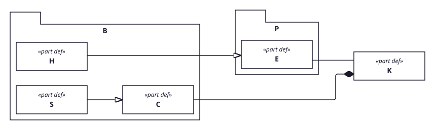

The smallest reproduction: folder B holds C, S (specializing C) and H, folder P holds E and the root holds K. The
connectors H to E, E to K and C to K leave their folders without crossing, whatever order the members were added in.

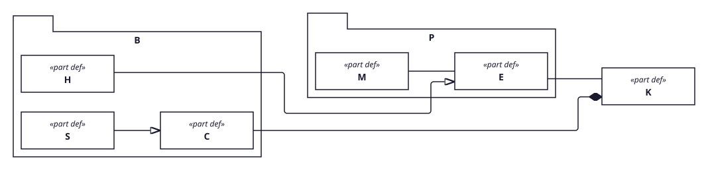

Adds a connector M to E inside folder P, which the connector H to E entering the folder must not cross.

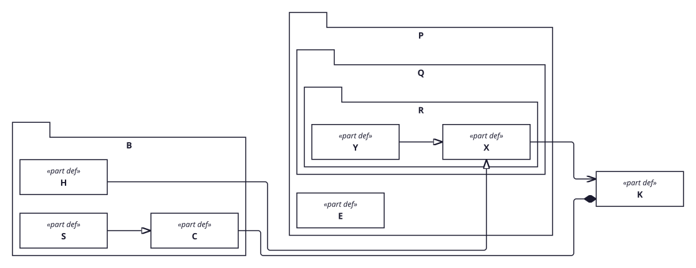

H reaches X three containers deep, and X and C reach the root definition K; the unconnected E sits beside the nested
folders.

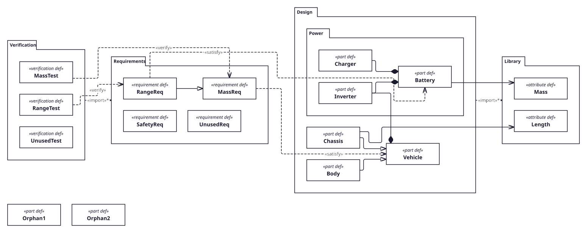

The reproduction scaled up: design, requirements, verification and library packages, a nested power package,
keyword-labeled connectors between leaves and between packages, and unconnected definitions.

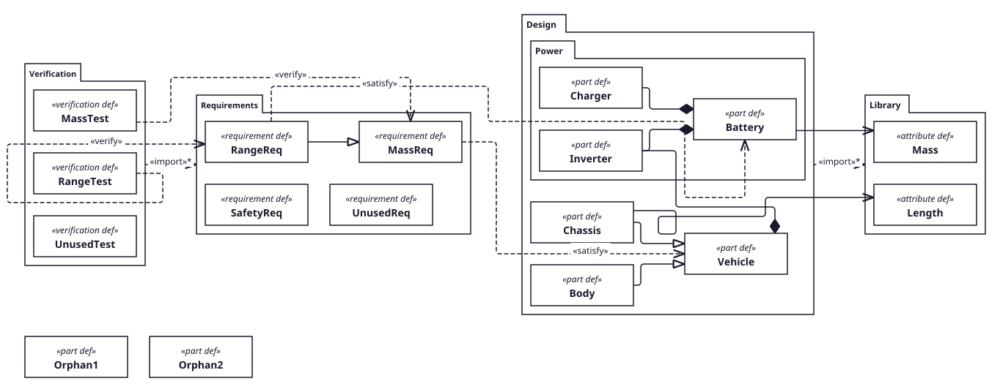

The same diagram through the CanvasNet raster renderer.

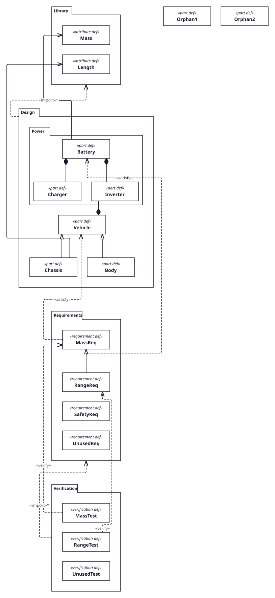

The same graph with the SysML General View direction: generals above their specifics.

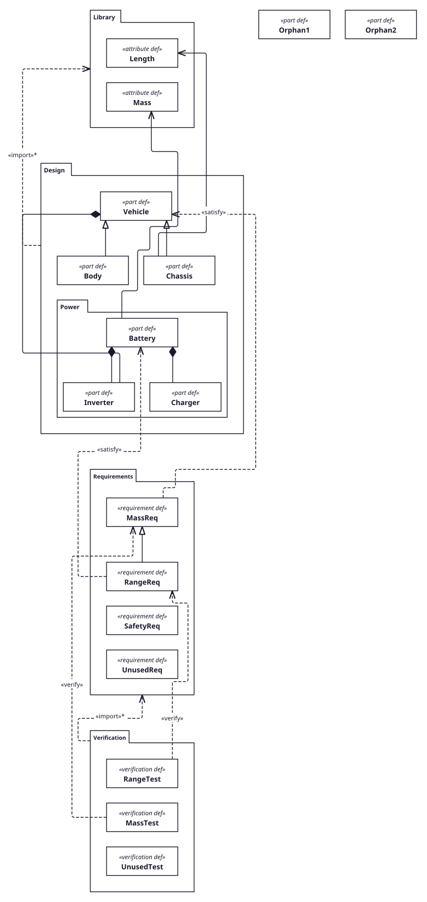

The same diagram through the CanvasNet raster renderer.

## SysML general view and usage tree

Two larger diagrams in the shape consumers produce: a General View with package folders, definitions and usages as
nodes, composite and typing connectors and scattered insertion order, and a dense usage tree with one owner, a dozen
usages and shared and unused definitions.

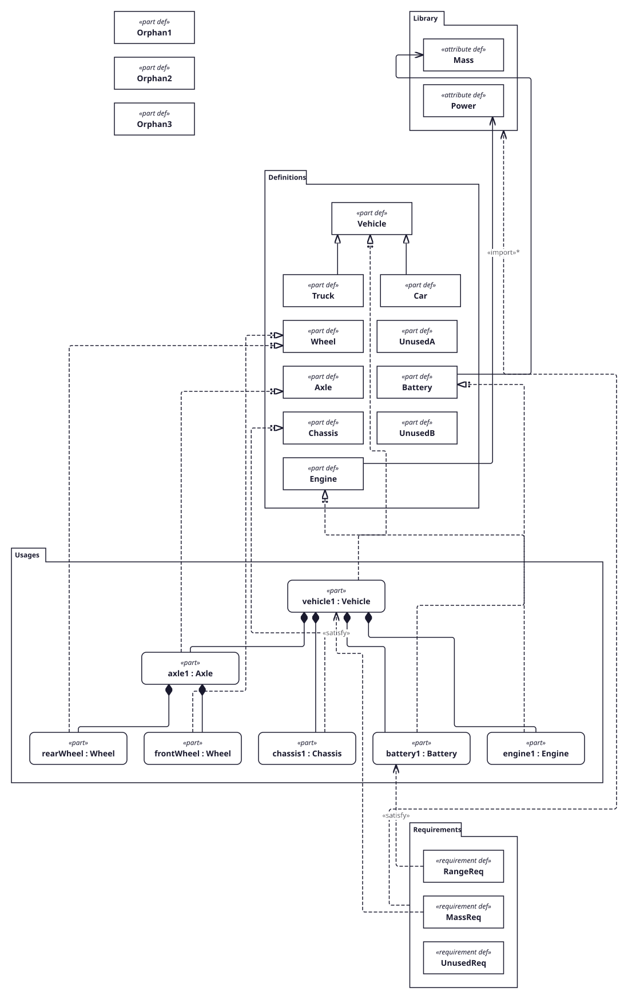

Folders, definitions and usages joined by composite (filled diamond) and typing (hollow triangle with two dots)
connectors, many of them across package borders, with orphan definitions tucked into free space.

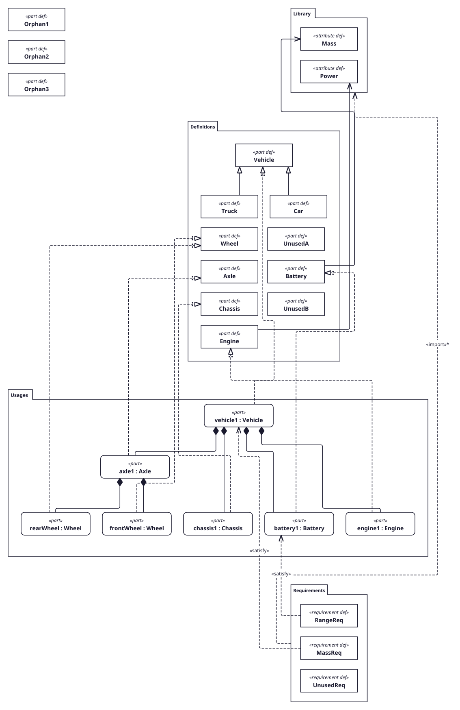

The same diagram through the CanvasNet raster renderer.

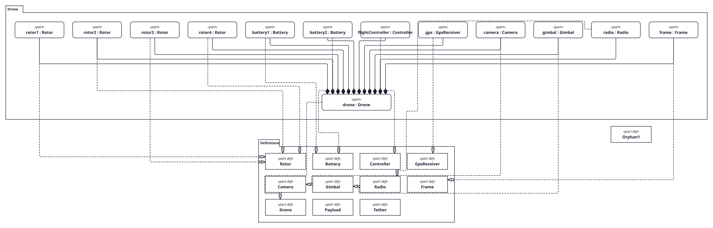

One owner with a dozen usages typed by shared definitions, plus unused definitions packed beside the tree.

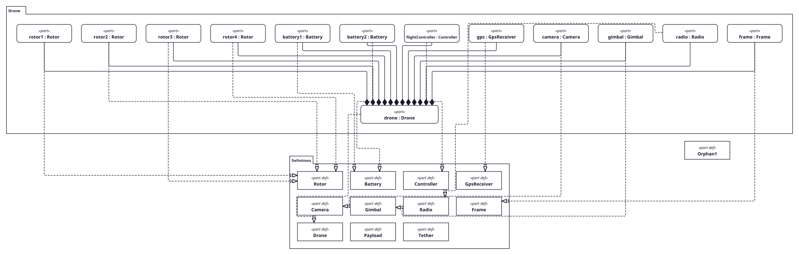

The same diagram through the CanvasNet raster renderer.

## Interconnection corridors and LayerSpacing (#60)

Parts and ports joined by labeled connectors with end labels, laid out to the right. The corridors between layers hold
the labels as well as the routing lanes, and the LayerSpacing option sets the least gap between adjacent layers: a
floor, since the connector routing may still need more. An unset option keeps the historical 70 px corridor.

The default: corridors sized by the labels and lanes they hold.

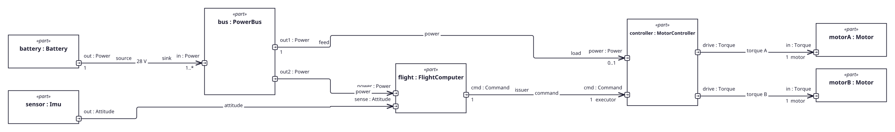

The same diagram through the CanvasNet raster renderer.

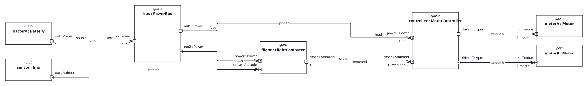

A spacing below what the labels and lanes need changes nothing: the option is a floor, not a ceiling.

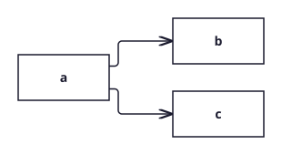

The Rendering#60 reproduction: three unlabeled boxes with the default 70 px corridor between the layers.

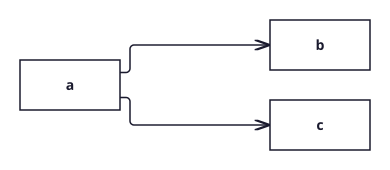

The same graph with LayerSpacing set to 150: the corridor between the layers is 150 px wide, leaving room for connector
labels and bends at the cost of a wider canvas.

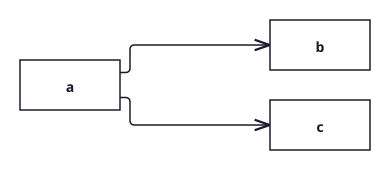

The same diagram through the CanvasNet raster renderer.

## Flows, state machines and isolated definitions

Small diagrams that must stay exactly as good as before: a downward action flow, a state machine with back edges, and a
tall connected chain beside isolated definitions that the auto algorithm now packs into the free space.

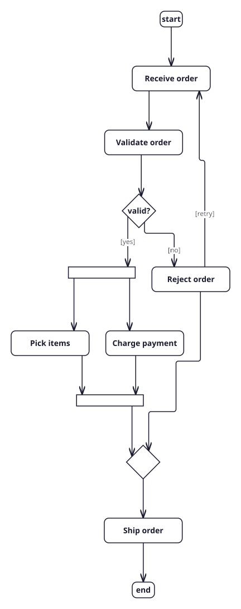

A downward flow with a guarded decision, a fork and join pair, a merge and a retry edge back to an earlier action.

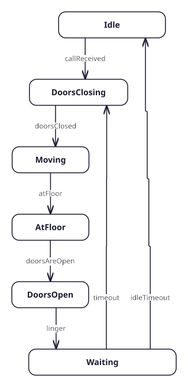

A downward state machine whose reversed edges end in wrap-around corridors.

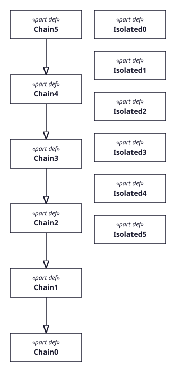

The auto algorithm lays out the chain with the layered algorithm and tucks the isolated definitions into the free space
beside it.

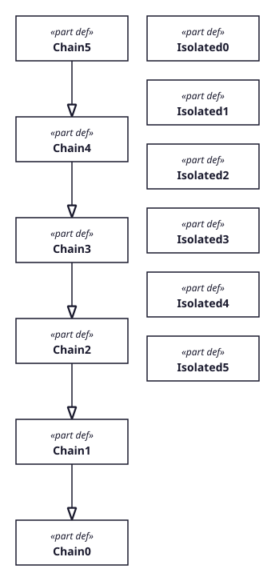

The same diagram through the CanvasNet raster renderer.

## Measurements

The [metrics table](metrics.md) lists, for every scene above, the connector crossings, the largest empty square relative
to the block height (B4), the block area ratio (B5) and the canvas size before (main@219650c) and after the
layout-quality work. The gallery test that writes it fails if any scene gets worse than the baseline.
