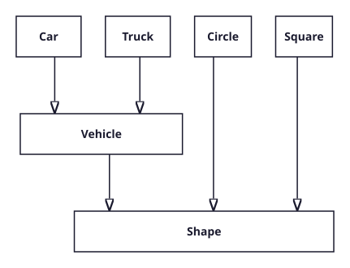
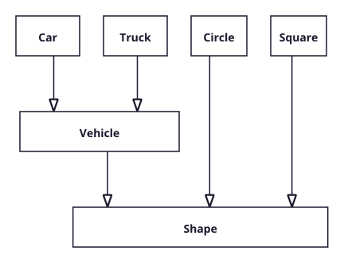
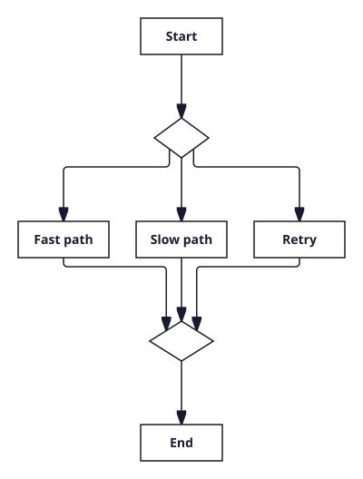
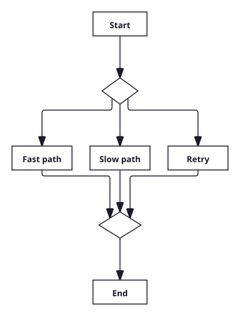

# Layout regressions

Kept as its own group per its organizing principle: bug history, not topology. Small graphs that reproduce and pin down
a specific layout bug once fixed, kept as permanent visual and numeric evidence that it stays fixed.

[Back to the gallery index](../README.md)

## Isolated-node layer-gap fix

Small graphs that reproduce and pin down a specific layout bug once fixed, kept as permanent visual and numeric evidence
that it stays fixed.

Regression coverage for the isolated-node layer-gap fix: a genuinely isolated node (Isolated, zero edges) shares its
layer with a dummy bend point created by an unrelated long edge (LongSource to LongTarget). The crossing minimizer now
clusters isolated nodes at the end of the layer's order, and coordinate assignment squeezes any resulting gap down to
the standard node spacing, instead of inheriting the dummy's unrelated port-alignment floor as an inflated gap.

## Straight final runs on a shared face (#57)

Several connectors ending on one face of a box used to step a few pixels sideways right before their end marker whenever
the source box's face covered the target's port position, because the even port spacing ignored where the other end sat.
The layered pipeline now slides the ports onto a common coordinate when both faces allow it, so those runs are straight.
This is on by default and changes the geometry of existing diagrams whose connectors shared a face. The before rendering
is in the pull request, not in the repository.

Regression coverage for Rendering#57: every specialization connector runs straight into its hollow triangle, with no
sideways step before the marker, while the ports on the shared face stay apart and in order.

The same diagram through the CanvasNet raster renderer.

## Diamond outline anchors (#58)

Connectors to or from a diamond node used to attach to its bounding box, leaving a gap and a hook between the shape and
the line. The diamond shape now anchors connectors on its outline — the vertex for a single connector on a face — and
they leave it along the axis. When several connectors share a face they spread along the outline at least a marker width
plus 4 px apart, so arrowheads never touch (the diamond grows to make room). The before rendering is in the pull
request, not in the repository.

Regression coverage for Rendering#58: every connector to or from the two diamonds starts or ends on the diamond outline
and leaves it perpendicular to its face, with no gap or hook. The Fast path, Slow path, and Retry arrowheads on the
merge diamond are separate, a marker width plus 4 px apart.

The same diagram through the CanvasNet raster renderer, whose diamond outline matches the SVG polygon.

## Back-edge entry approach

A state machine whose reversed (back) edges end in a wrap-around corridor and whose edges all end in an open chevron.
The final straight approach of a back edge is sized from the decoration it carries, so the rounded corner never
collapses into the arrowhead, and connector labels are kept clear of node borders.

Regression coverage for the back-edge entry approach: the two back edges (timeout and idleTimeout) end in a wrap-around
corridor whose final leg is at least the rendered chevron plus the corner radius, so the chevron sits on a clean
straight run with no collapsed corner inside it, and no connector label's background cuts a node border.
