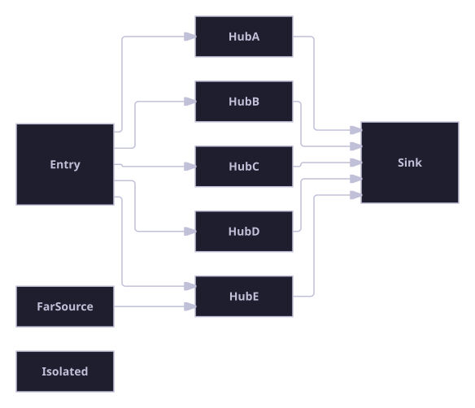
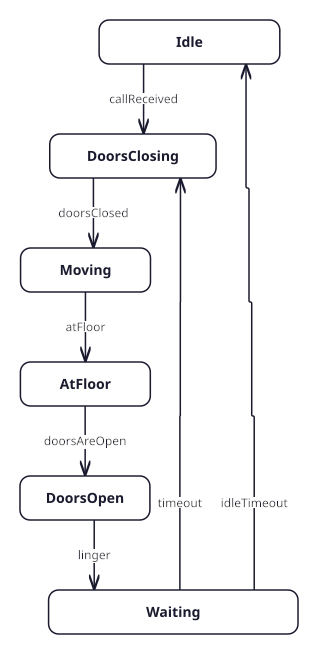

# Layout regressions

Kept as its own group per its organizing principle: bug history, not topology. Small graphs that reproduce and pin down
a specific layout bug once fixed, kept as permanent visual and numeric evidence that it stays fixed.

[Back to the gallery index](../README.md)

## Isolated-node layer-gap fix

Small graphs that reproduce and pin down a specific layout bug once fixed, kept as permanent visual and numeric evidence
that it stays fixed.

Regression coverage for the isolated-node layer-gap fix: a genuinely isolated node (Isolated, zero edges) shares its
layer with a dummy bend point created by an unrelated long edge (LongSource to LongTarget). The crossing minimizer now
clusters isolated nodes at the end of the layer's order, and coordinate assignment squeezes any resulting gap down to
the standard node spacing, instead of inheriting the dummy's unrelated port-alignment floor as an inflated gap.

## Back-edge entry approach

A state machine whose reversed (back) edges end in a wrap-around corridor and whose edges all end in an open chevron.
The final straight approach of a back edge is sized from the decoration it carries, so the rounded corner never
collapses into the arrowhead, and connector labels are kept clear of node borders.

Regression coverage for the back-edge entry approach: the two back edges (timeout and idleTimeout) end in a wrap-around
corridor whose final leg is at least the rendered chevron plus the corner radius, so the chevron sits on a clean
straight run with no collapsed corner inside it, and no connector label's background cuts a node border.
